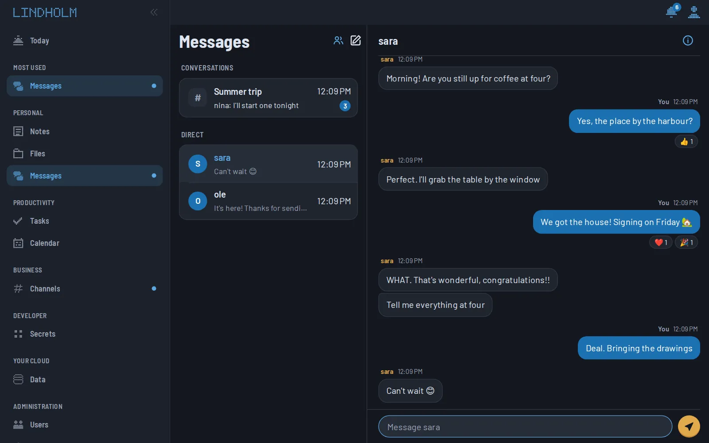
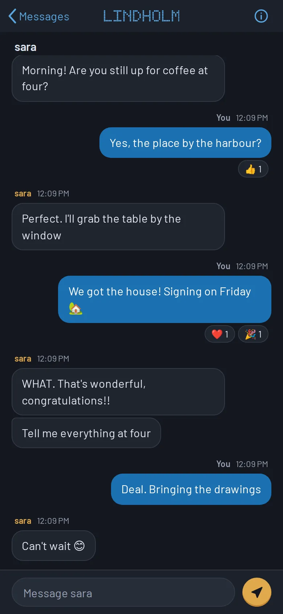
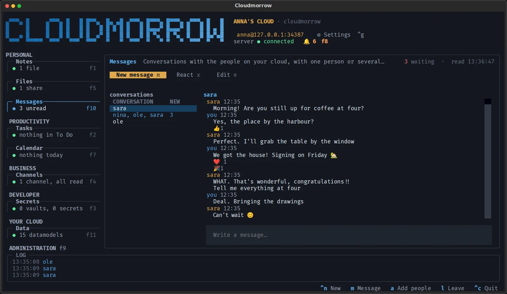

# Messages

Conversations with the people on your cloud, the way a phone's messages
are: pick who it is to, one person or several, and the conversation with
exactly them is there. Kept on your own cloud, and nowhere else.

A [Quill](https://github.com/Cloudmorrow/cloudmorrow/blob/main/docs/QUILLS.md)
for Cloudmorrow: install it from the Quill Catalog, or from this repository
with `cm quill add --source https://github.com/Cloudmorrow/quill-messages --ref v1.1.0`.

<p>


</p>


(A throwaway cloud made for the pictures, named after nobody real.)

- **A new message is to the people you pick.** The pen opens a To box:
  tap a person in the list under it and they become a pill in the box,
  with an X that takes them out again; one person, or several. Then you are
  in the conversation with exactly those people, writing.
- **The conversation is already there.** Pick somebody you have written
  to and the conversation with them opens, whether or not it existed a
  moment ago; them picking you finds the same one. The same people again,
  in any order, from any side, is the same conversation. It is called after
  the others in it.
- **Reactions.** One tap puts your ❤️ on a message; yours again takes it
  back. Six to choose from, counted under the line.
- **Unread, and a push.** What you have not read is counted beside each
  conversation and on the app's icon, and everybody else in a conversation
  gets a push when somebody writes. Opening a conversation, on any device,
  reads it.
- **Yours.** Every message is sealed at rest, on your own server. A message
  is its author's to change or take back, and nobody else's.
- **Room for the rest of your messaging.** Every conversation says where it
  is. Today that is here; the shape is there for a bridge to bring in what
  you say on Messenger, WhatsApp and the like, and keep it here. See
  *Where it goes*.

## Messages and Channels

[Channels](https://github.com/Cloudmorrow/quill-channels) is a team's rooms:
`#general` that everybody is in, named channels with people added and
taken out, threads, mentions and pinned messages. Messages is between
people: a conversation is the people in it and nobody else — nothing is
named, nothing is joined or left, there is no room everybody is in, and
nothing is pinned. They keep their own conversations and messages; install
both and each is what it is.

## Using it

A conversation is its people, and that *is* the access rule: whoever is in
it reads it and writes in it, and nobody else sees that it exists. It is
never made from a form: pick who it is to and it is there — `sara` alone,
or `sara` and `ole` — whether or not it was a moment ago, and the others
picking you finds the same one. A conversation stays the people it was
made between: to write to somebody else as well, pick them all and that is
another conversation.

Everyone can write to everyone on the server; there is no setting for that.

**Unread** is when you last looked: everything somebody else wrote after
that is unread, and opening the conversation, on any device, moves it on.
Writing in a conversation reads it.

#### In the web app

The **Messages** tab: the conversations, with what is unread in each, then
the open one, newest at the bottom; on a computer both side by side. The
pen beside the title is a new message: a **To:** box, and everybody under
it — tap a name and it is a pill in the box, tap the pill's X and it is
out; type to narrow the list, Enter takes the one name left. *Write to
Sara and Ole* opens the conversation with exactly them. Tap a message for
its reactions. Push wakes the app the moment somebody writes.

#### In the terminal app

The **Messages** card: the conversations on the left, the open one on the
right. `n` is a new message: space ticks the people it is to, the To line
says who, Enter opens the conversation with them. `e` deletes one of
yours; on a line, `x` reacts.

#### On the command line

```
cm messages list                      the conversations, with what is unread
cm messages show sara                 the conversation, newest at the bottom
cm messages say sara "coffee at four?"
cm messages react sara 3f2a ❤️        a line is named by the start of its id, as show prints it
```

A conversation is named by the people in it (`sara`, or `ole, sara`);
`show` prints each line's id in the margin.

## Where it goes

Messages 1.0 is the conversations on your own cloud. The point of the next
versions is to collect the rest of your messaging here too — what you say
on Messenger, on WhatsApp, and the like — so that your messages are yours,
on your server, whichever app the other person uses. The shape is laid
down now so nothing has to move later:

- A conversation says where it is (`via`: here, Messenger, WhatsApp), whom
  it is with there (`address`: a number, a handle) and the service's own id
  for it (`outside_id`); a message brought in carries the service's id for
  it too, so a bridge never brings the same one in twice.
- A bridge is this Quill's own job or webhook, run as each person over
  their own conversations, delivering what arrives as a message *by* the
  outside sender into the right conversation — the core's deliveries, which
  Mail already uses — and sending on what is written here in a conversation
  held elsewhere.
- Each person connects their own account on a settings screen behind the
  gear, never a setting of the server's; the service's host goes in
  `[[fetch]]`, the token in their vault.

None of that is built yet, and the services set the terms: Messenger and
WhatsApp are reached through Meta's platform, which wants a developer
account and an approved app. Until then, nothing in Messages reaches
outside your server.

## What it adds to your Cloudmorrow

`cm quill check` prints this for you; it is here for the catalog page.

| | |
| --- | --- |
| Datamodels | introduces `messages.conversation` (a space between the people picked), `messages.message` and `messages.reaction` |
| Screens | Messages, a thread of conversations, on the phone, the web app, the terminal, `cm messages`, and to your assistant |
| Code | none: everything is declared, and the core's spaces and thread kit do the rest; reaches nothing outside |

## Working on it

```
uv sync                  # .venv with Cloudmorrow and pytest
cm quill check           # the manifest, as a server would install it
cm quill test            # tests/, against the real record store and gate
cm quill test --sandbox  # the same, with quill.py in the sandbox
cm quill dev --local     # a throwaway server here, reinstalled as you save
```

The pictures in `screenshots/` (`<screen>-desktop.webp` 1600×1000,
`<screen>-phone.webp` 780×1688, `<screen>-tui.webp` 1600×930, captioned in
quill.toml's `[[screenshots]]`) are taken from a throwaway cloud named
after nobody real, never from anybody's own cloud. Retake them when the
screen changes.
